<div align="center">



<a href="https://github.com/mary-angel-x">  </a> 


**she/her · python teacher · AI researcher · curious developer · vegan · traveler**


</div>

<br/>

## 🍄 `about me`

```python
class AboutMe:
    name       = "Maria"
    role       = ["Python Teacher 🐍", "AI Researcher 🔬", "Developer 💻"]
    based_in   = "🌍 Earth (nomad since 2023)"
    languages  = ["Python", "English", "Russian"]
    hobbies    = ["coding", "teaching", "Dota 2", "anime", "learning", "travel"]
    currently  = "researching how neural networks think from the inside"
    learning   = ["C", "ML", "Math", "Computer Science", "System Design"]
    belief     = "Consciousness is like a protocol"

    def say_hi(self):
        print("Thanks for wandering into my forest! 🐸")
```

<br/>

## 🐸 `what i'm working on`

<table>
<tr>
<td width="33%" valign="top">

### 🔬 Interp Research
Independent **mechanistic interpretability** research — looking for directions inside models that shape their behavior.

</td>
<td width="33%" valign="top">

### 🐍 PYTHONCRAFT
My own **Python course for kids** — from first `print()` to games in Pygame.

</td>
<td width="33%" valign="top">

### 🎨 WEBCRAFT
An **HTML/CSS course for kids** — building first websites step by step.

</td>
</tr>
</table>

<br/>

## 🌿 `skills & tools`

<div align="center">

**languages**


**frameworks & libraries**


**ML & interpretability**


**tools**


</div>

<br/>

## 🐌 `find me`

<div align="center">

[](https://mary-angel-x.github.io)
[](https://t.me/samadhi404)
[](https://instagram.com/shanti.sabai)

</div>

<br/>

<div align="center">




</div>
